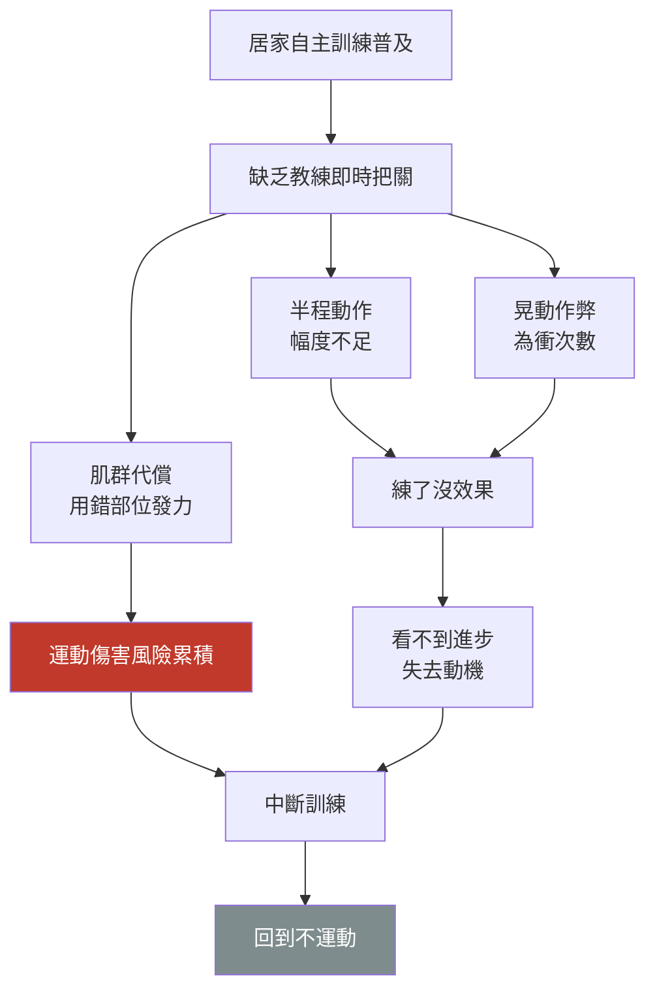
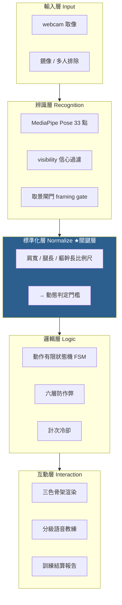
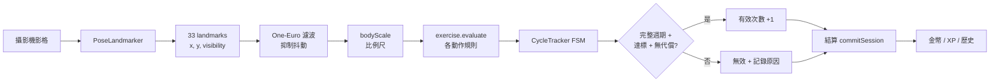
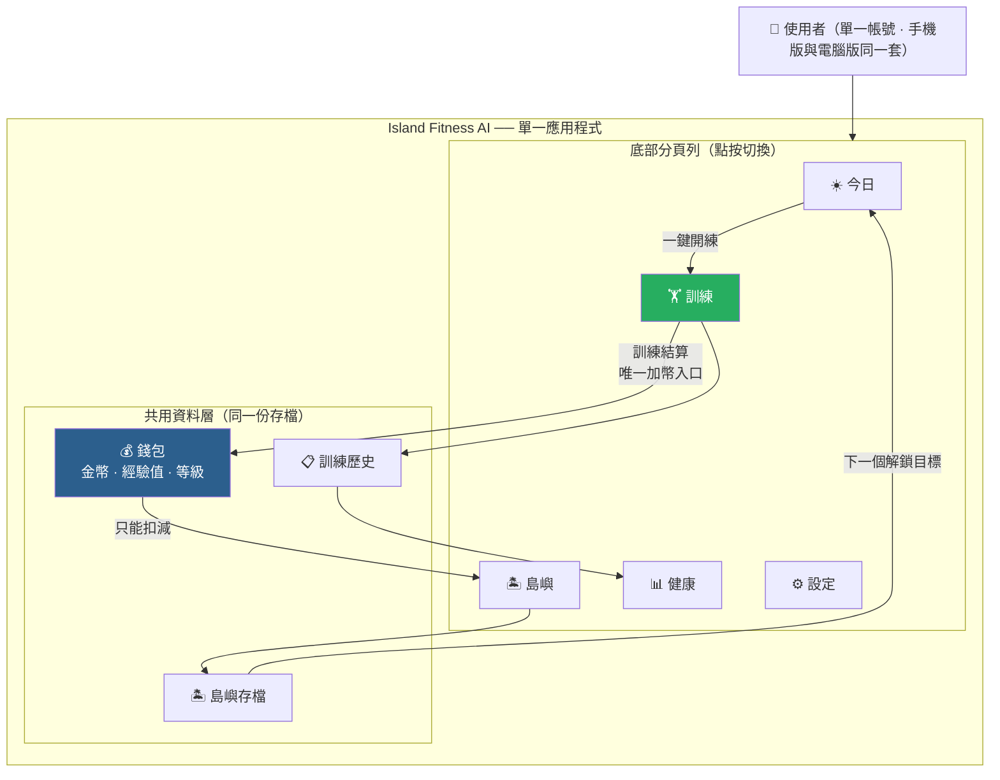
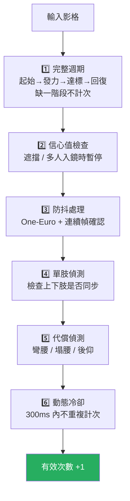
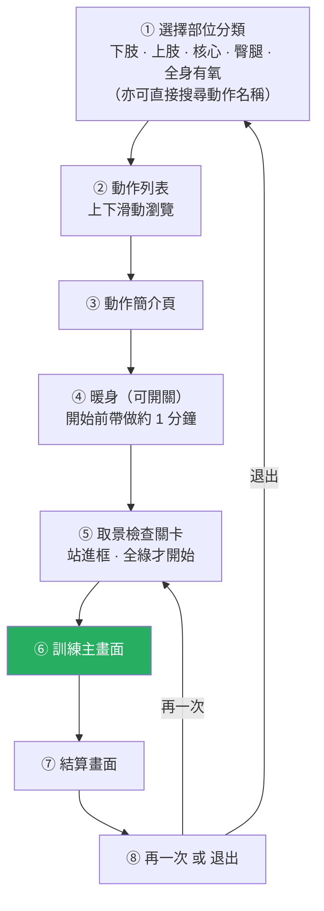
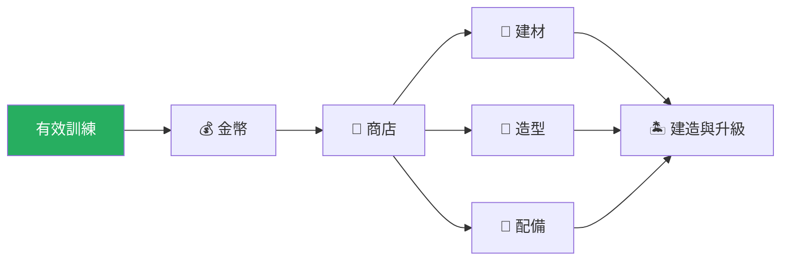
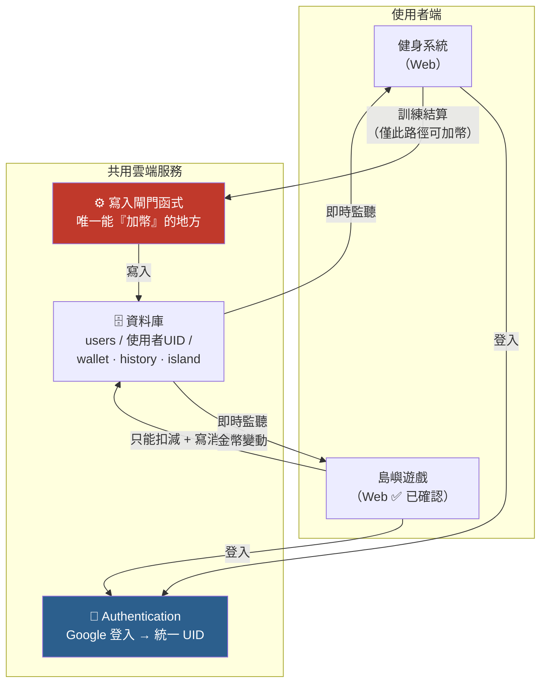
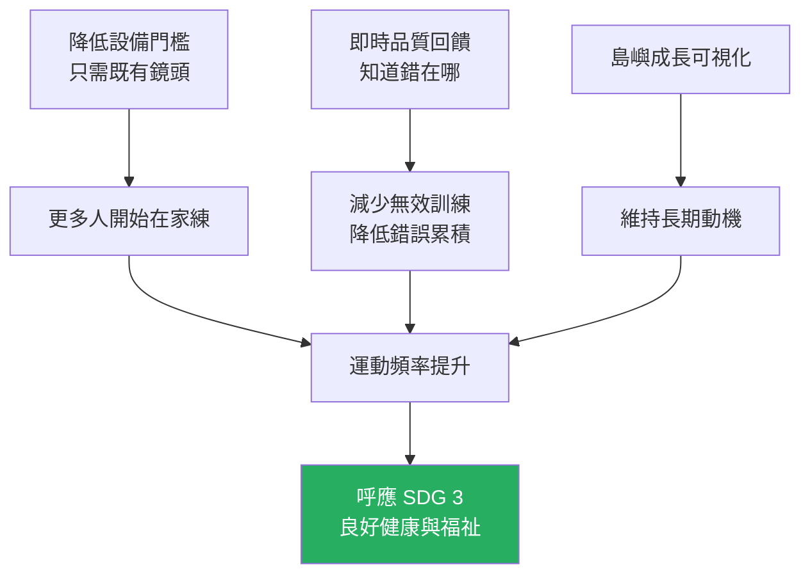
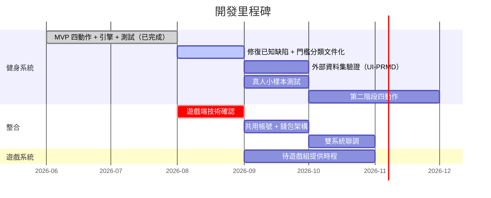

# 育秀盃創意獎　競賽企劃書（AI 應用類）

## Island Fitness AI — AI 健身動作品質判定與島嶼建設連動系統

> **作品名稱（中）**：AI 健身動作品質判定與島嶼建設連動系統
> **作品名稱（英）**：Island Fitness AI — AI Fitness Motion Quality Assessment and Island Construction Linked System
> **技術領域**：人工智慧 · 電腦視覺 · 健康科技 · 遊戲化設計
> **文件版本**：v2 整合版（2026-08-13）
> **文件性質**：**理解版**——為了讓健身組與遊戲組雙方看清楚「最終要做成什麼」而寫，長度超出初賽 10 頁限制。送件前需另行精簡。

---

## 0. 這份文件怎麼讀

### 0.1 為什麼要有 v2

v1（2026-06-03）寫於實作開始之前，因此有三個問題：把「規劃」寫成了「已完成」、把「工程校準值」寫成了「文獻結論」、以及完全沒有描述兩組系統實際要怎麼接。v2 修正這三點，並補上一份 v1 沒有的東西：**誠實的完成度界線**與**可被外部檢驗的驗證計畫**。

### 0.2 全文標記約定

| 標記 | 意義 |
|:---:|---|
| ✅ | **已實作並通過自動化驗證**——現在打開就能跑 |
| 🔷 | **規劃中**——有明確規格與作法，尚未實作 |
| ⬜ | **待確認**——需要遊戲組回覆後才能填寫，本文件不臆測 |
| ⚠️ | **已知限制**——主動揭露的邊界或缺陷 |

### 0.3 本文件的自我要求

1. **不把未實作的寫成已實作。**
2. **不把工程決策偽裝成文獻結論。** 每個判定門檻都標明它屬於哪一類知識來源（見 §3.4）。
3. **不引用未經查證的文獻。** 本文所有引用皆已逐筆核對原文、DOI 與出版來源（見 §9）。
4. **不臆測遊戲組的實作。** 未知處一律標 ⬜。

---

## 1. 作品說明介紹

### 1.1 中文說明

居家健身最大的瓶頸不是「不知道要做什麼動作」，而是「沒有人告訴你做得對不對」。現有健身 App 多以計時與計次為核心，能算出你做了幾下，卻無法判斷這幾下是否有效——半程動作、肌群代償、為衝次數而晃動身體，這些都會被算成「完成」。練了沒效果事小，錯誤動作長期累積造成運動傷害事大。

本作品提出「**不是計次，而是品質確認**」的設計理念，並用一套完整產品把它落地：使用者只需一支家中既有的鏡頭，系統即以 Google MediaPipe Pose 即時擷取人體 33 個骨架關鍵點，再由本團隊自行設計的**可解釋規則式幾何引擎**判定動作完整性、達標深度與代償行為。只有同時滿足「完整週期 + 達標深度 + 無代償」的動作才被認定為有效次數。判定過程以紅／黃／綠三色骨架與分級語音即時回饋，使用者不需盯著螢幕也能修正姿勢。

在動機層面，本作品將訓練成果導入一座**可經營的島嶼**。金幣只能來自通過 AI 驗證的有效動作，並投入島嶼的建築、裝飾與土地擴張，使抽象的運動數據轉為看得見、可累積的成長軌跡，形成「正確訓練 → 金幣 → 島嶼成長 → 再訓練」的正向循環。健身系統負責回答「怎麼做才對」，島嶼遊戲負責回答「為什麼要持續做」。

### 1.2 English Description

Home fitness suffers less from a lack of exercise content than from a lack of supervision. Most fitness applications count repetitions but cannot verify whether those repetitions were performed correctly, allowing half-range motions, muscular compensation, and body-swinging to be recorded as valid work.

Island Fitness AI addresses this by shifting the goal from *counting* to *quality verification*. Using only a consumer-grade camera, the system extracts 33 skeletal landmarks in real time via Google's MediaPipe Pose, then applies a self-developed, fully explainable rule-based geometric engine to evaluate cycle completeness, target depth, and compensatory movement. A repetition is credited only when all three conditions hold. Feedback is delivered through a tri-colour skeleton overlay and prioritised voice coaching, allowing correction without visual attention.

Verified training results are converted into coins that can only be earned through AI-validated repetitions, and spent on constructing a persistent island. This creates a closed motivational loop — correct training yields coins, coins grow the island, island growth sustains engagement. The fitness system answers *how to do it right*; the island game answers *why keep doing it*.

---

## 2. 作品動機

### 2.1 問題結構

這條鏈上有兩個斷點，而市面上的產品各只處理一個：

- **穿戴／器材類**（智慧健身鏡、體感遊戲配件）能處理品質，但需要額外硬體，門檻高。
- **影片／計次類 App** 能處理動機（課程、連續紀錄），但無法判斷品質。

**「單鏡頭、零額外硬體、能判品質」這一格是空的**，這是本作品切入的位置。

### 2.2 為什麼「計次」不等於「有效」

| 使用者做的事 | 一般 App 判定 | 本系統判定 |
|---|---|---|
| 標準深蹲，髖低於膝，起身回穩 | 計 1 次 | **有效 1 次** ✅ |
| 只蹲到一半就起來 | 計 1 次 | **無效**，回饋「再往下蹲」 ✅ |
| 用彎腰代替下蹲（背拱起） | 計 1 次 | **無效**，回饋「背部打直，用臀部往後坐」 ✅ |
| 在底部快速抖動 | 可能計數次 | **不重複計次**（計次冷卻） ✅ |
| 人走出畫面一半 | 繼續算 | **凍結判定**，先提示調整站位 ✅ |

### 2.3 我們相信的一件事

> 讓運動持續下去的，不是更多的課程內容，而是**確定自己做對了**，以及**看得見自己累積了什麼**。

前者靠 AI，後者靠遊戲。這是本作品把兩套系統綁在一起的根本理由——**不是為了好玩才加遊戲，而是因為品質驗證本身需要一個能長期累積的載體，否則「做對了」只是一個瞬間的綠燈，第二天就消失了。**

---

## 3. 執行計劃（使用 AI 工具、執行方法）

### 3.1 技術路線選擇

判定「動作對不對」有兩條路，我們明確選擇了第二條：

| | 路線 A：端到端深度學習 | 路線 B：預訓練感知 + 規則引擎 ← **本作品** |
|---|---|---|
| 作法 | 蒐集大量標註影片，訓練分類器直接輸出「對/錯」 | 用成熟模型取得骨架，再以幾何規則判定品質 |
| 回饋能力 | 只能說「錯」 | **能說「錯在哪、怎麼改」** |
| 資料需求 | 大量標註資料 | 不需訓練資料 |
| 可查核性 | 黑盒，參數無法解釋 | **每個門檻都能被逐一檢視** |
| 裝置負擔 | 高 | 低（引擎實測 0.0006 ms/幀） |

**選 B 的決定性理由是回饋能力。** 本作品的價值主張是「準教練級的矯正」，而教練的價值在於指出**哪裡**錯了。一個只會輸出「這下不算」的黑盒模型，無法兌現這個承諾。

### 3.2 系統分層架構 ✅

**標準化層是本系統的關鍵差異化。** 若以絕對像素距離當門檻，同一個動作在不同身高、不同鏡頭距離下會得到完全不同的判定。本系統改採比例式門檻：水平方向以**肩寬**為尺、垂直方向以**腿長／軀幹長**為尺。

**實測驗證** ✅：鏡頭遠近 scale 0.7×～1.15× 全部維持 4/4 正確計次；1.3× 被取景閘門判為「太近」而擋下（設計行為）。

### 3.3 資料流 ✅

⚠️ **關鍵限制（主動揭露）**：判定層**只使用 x, y 二維投影座標，不使用 z 軸深度**。原因是單鏡頭的 z 估計在居家環境下不可靠。代價是：使用者相對鏡頭的前後傾斜與斜站角度，系統無法區分。因此系統對每個動作規定建議機位（見 §4.3）。

### 3.4 判定門檻的三類知識來源 ★

這是本作品在方法論上最重要的一個設計。**我們不主張每一個數字都有論文出處**——任何真實系統的參數都必然包含工程校準。我們主張的是：**每個數字都清楚標明它屬於哪一類，不混為一談。**

| 類別 | 定義 | 文件寫法 |
|---|---|---|
| **I 類** | 對應該運動領域公認的標準 | 引用標準，**並明確說明本系統取值與標準的差距及理由** |
| **II 類** | 領域慣例，但無正式成文標準 | 說明為教練慣例，**不引用論文** |
| **III 類** | 純工程參數，與運動標準無關 | 說明為實測校準，附邊界值與緩衝區 |

#### 標準從哪裡來：動作標準角度的建立方法 🔷

《初步發想計劃》對此已有明確作法：「**可以透過去專業健身資料中取得正確的動作角度**，進而據以判斷使用者對還是錯。」正式版將此作法制度化，作為 I 類與 II 類門檻的來源：

**每一項動作皆建立一份「標準卡」**，內容包含：該動作的關鍵關節與判定角度、達標的容許區間、常見錯誤及其幾何特徵、以及該標準的出處類別（I／II／III）。標準卡是動作擴充的最小單位——新增一項動作等於新增一張標準卡，不必更動引擎。

⚠️ **兩點必須說明**：其一，蒐集自健身資料的角度多為**理想側面視角**下的數值，轉換到單鏡頭的二維投影條件時必然需要調整，該調整量將明確記錄而非隱藏；其二，凡無公開權威來源可依據者（如高抬腿的膝高標準），一律歸入 II 類標為教練慣例，**不假造文獻出處**。

#### I 類：對應公認標準的門檻

| 動作 | 領域標準 | 本系統實際執行 | 差距與理由 |
|---|---|---|---|
| 深蹲深度 | **平行蹲**：最大屈膝時大腿與地面平行（即髖與膝約略同高）。Schoenfeld (2010) 即以 partial／parallel／full 此一深度分類比較各深度之力學負荷與肌肉活化 | 達標時髖仍在膝上約 **0.058 × 腿長**（閘門容許至 0.10） | **比標準寬鬆**。原因：筆電鏡頭多為低角度仰拍，視角畸變使髖在影像中偏高。取捨：會放行一部分「接近平行但未達平行」的動作 |
| 伏地挺身深度 | 肘關節屈曲至約 **90°**（上臂與地面平行）。此為體適能檢測的通行標準——FitnessGram® 稱其為 90° push-up、President's Challenge 稱 right angle push-up、ACSM／YMCA 肌耐力檢測亦以此為完成一次之判準 | 觸發計次時肘角約 **117.5°**（最深處 95.9°） | **比標準寬鬆**。原因：側面拍攝時遠側肢體被遮擋，角度估計偏差大 |

⚠️ **我們主動揭露這個偏移。** 兩項門檻皆比其對應標準寬鬆，這是為了在真實居家鏡頭條件下降低誤拒率所做的取捨，而非疏漏。🔷 後續將以外部資料集重新標定（見 §3.6）。

#### 實測佐證：專業示範影片的角度分佈 ✅

2026-08-23 以本系統自身的模型與參數（`pose_landmarker_full` + 完整前處理），量測 14 支專業示範影片、1,864 個有效幀，取得標準動作的實際分佈。**這是本系統門檻首次與非自製資料比對。**

| 項目 | 專業示範實測 | 本系統門檻 | 差距 |
|---|---|---|---|
| 伏地挺身肘角 | 中位 **65.6°**（p25 53.3°／p75 90.8°） | 觸發於約 117.5° | 系統寬鬆約 **52°** |
| 高抬腿膝高 | 中位 **膝高於髖 0.113 × 軀幹長** | 膝在髖下 0.085 即達標 | 系統寬鬆約 **0.20** |
| 開合跳腳距 | 中位 **1.705 × 肩寬** | 1.0–1.2 × 肩寬 | 系統寬鬆 |
| 深蹲軀幹前傾 | p90 **25.2°**（中位 4.4°） | 45° 阻擋 | 餘裕約 **20°**，不誤殺標準動作 |

三項門檻的實測差距，量化證實了上表主動揭露的「比標準寬鬆」。軀幹前傾一項則顯示 45° 對標準動作有充分餘裕——同時也證實本系統合成器產生的正常深蹲軀幹恆為 0°，與真人分佈不符（詳見 §3.6 對合成資料侷限的說明）。

⚠️ **深蹲深度一項刻意不列入本表。** 七支同樣標榜標準示範的影片，量出的最深值從 −0.489 到 +0.534，跨度超過 1.0；其中四支整支影片沒有任何一幀達到系統門檻。此變異主要來自**機位與取景**而非動作本身，因此該批資料不足以標定深度門檻，亦不得據以調整之。完整方法、逐支數據與已知限制見《門檻實測報告_教練示範影片》。

#### II 類：領域慣例、無正式標準

| 動作 | 慣例 | 本系統實際執行 |
|---|---|---|
| 高抬腿 | 膝抬至髖高 | 膝在髖下約 0.085 × 腿長即達標 |
| 開合跳 | 手過肩 + 腳超肩寬 | 肩寬 1.0～1.2 倍為腳距門檻 |

#### III 類：純工程參數（與運動標準無關）

| 參數 | 值 | 校準依據（實測） |
|---|---|---|
| 軀幹前傾阻擋 | 45° | **實測邊界**：前傾峰值 45.0° 仍計次、46.8° 起拒絕。合成代償樣本 46.4°，緩衝僅 1.4° ⚠️ |
| 計次冷卻 | 300 ms | 避免底部抖動重複計次 |
| 可見度門檻 visMin | 0.4 | MediaPipe 信心值分佈：正常入鏡 >0.7、邊緣 0.3–0.5、出框 <0.3 |
| 移動平均視窗 | 5 幀 | 3 幀平滑不足、8 幀削平快速動作 |
| One-Euro 濾波 | minCutoff 2.0 / beta 0.5 | 峰值保留率 0.845 → 0.94，殘餘抖動僅增 14% |
| 取景滾動視窗 | 12 幀 / 3 幀壞 | ≈0.4 秒 @30fps，涵蓋「連續壞幀」與「25% 壞幀率」兩種樣態 |
| 掉幀容忍 | 500 ms | 必須大於視窗排空時間（≈400ms），否則形同虛設 |
| 人體跨幅 | 0.30–0.95 | <0.30 太遠、>0.95 太近 |
| 跳躍上緣留白 | 0.18 | 實測騰空高度 0.10–0.15 畫面高，留約一個頭的安全邊際 |

### 3.5 現階段驗證：合成骨架壓力測試 ✅

系統目前有 **114 組自動化測試，全數通過**，分佈如下：

| 測試檔 | 案例數 | 範圍 |
|---|---:|---|
| framing.test.js | 39 | 取景判定（太近／太遠／出框／跨幅／留白） |
| engine.test.js | 25 | 核心引擎（四動作正負樣本、不變性、防抖、冷卻、交替判定回溯撤銷） |
| coach-policy.test.js | 11 | 教練回饋決策 |
| display-colors.test.js | 8 | 骨架顏色語意一致性 |
| goals.test.js | 7 | 目標達成與連續天數 |
| geometry.test.js | 6 | 幾何工具函式 |
| today.test.js | 12 | 今日統計、跨日處理、每日分鐘與本週天數 |
| calories.test.js | 3 | 熱量公式 |
| normalize.test.js | 3 | 人體幾何正規化 |
| **合計** | **114** | |

**擾動維度**：縮放 0.7–1.15、平移、雜訊 0.012–0.025、遮擋、出框裁切、5 組隨機種子（固定 seed，100% 可重現）。

**額外實測的穩健性邊界**（超出既有測試範圍）：

| 擾動 | 結果 |
|---|---|
| 雜訊 0.10（測試上限的 4 倍） | 5 組種子全部 4/4 正確 |
| 雜訊 0.15 | 開始掉次 [4,2,4,4,3] |
| 雜訊 0.30 | 全崩 [0,0,0,0,0] |
| 尺度 0.7 / 0.85 / 1.0 / 1.15 | 全部 4/4 |

✅ **已修復（2026-08-22）**：高抬腿的「單腿作弊」樣本原本**第一下必然被放行**（交替判定需與前一次比對側別，第一下無前例可比），實測做 4／8／12 次皆漏 1 次有效。

修法採「**回溯撤銷**」而非「第一下一律不給有效」——後者會讓每一組的第一下都冤枉正常使用者。現行作法為：第一下先放行但標記為「未經交替證實」，若下一下又是同側，則連它一併作廢。實測結果：單腿連做由 1 valid 降為 **0 valid**，而正常交替維持 **6/6 完全不受影響**。測試斷言亦由 `between(0,1)` 收緊為 `eq(0)`。

### 3.6 ⚠️ 現階段驗證的根本限制，與外部資料集計畫 🔷

**必須誠實說明的一件事：**

> 上述 114 組測試使用的是本團隊自行撰寫的合成骨架產生器。該產生器在建構時即把「髖低於膝」寫入姿勢生成邏輯，而判定引擎檢查的正是「髖低於膝」。**因此這 114 項測試證明的是「引擎與其規格自洽」，不能等同於「在真人身上的辨識準確率」。**

這是規則式系統驗證的固有問題，解法只有一個：**用不是我們生成的資料來測。**

#### 🔷 驗證計畫（三階段）

**階段二｜UI-PRMD 公開資料集** 🔷

| 項目 | 內容 |
|---|---|
| 來源 | University of Idaho Physical Rehabilitation Movement Dataset |
| 內容 | 10 種動作，**第一項即為 Deep squat**；另含 inline lunge、side lunge、sit-to-stand（對應本作品規劃中的弓箭步、側弓步） |
| 關鍵價值 | **同一批受試者另外錄製了 10 次「刻意不標準」的版本**——正負樣本皆為真人 |
| 規模 | 10 位健康受試者 × 每動作 10 次 |
| 擷取 | Kinect 22 關節 + Vicon 39 標記點 |
| 授權 | Open Data Commons PDDL（公眾領域，免費） |

⚠️ **本計畫的已知落差，先寫在這裡以免日後被視為隱瞞**：

1. UI-PRMD 為 **Kinect 22 關節**，本系統用 MediaPipe 33 點 → 需做關節對應（深蹲所需的肩／髖／膝／踝皆有，可行）
2. UI-PRMD 為 **3D 世界座標（mm）**，本系統吃 2D 影像正規化座標 → 需投影為虛擬相機視角，**此步驟會重新引入一個假設**
3. **只有深蹲對得上**；伏地挺身、開合跳、高抬腿在此資料集中沒有對應項目

因此階段二完成後，本作品能誠實宣稱的上限是：
> 「深蹲判定在 10 位真人受試者的外部公開資料上，準確率為 XX%；其餘三項動作尚未經外部資料驗證。」

**階段三｜自蒐真人樣本** 🔷：5–8 位身高差距明顯的受試者，每動作各做 10 次標準 + 10 次刻意錯誤，人工標註後計算混淆矩陣。此階段補上另外三項動作，並取得真實鏡頭條件（低角度、居家光線）下的表現。

⚠️ **若外部驗證結果低於現行門檻設定的預期，本團隊將據實揭露並重新標定門檻，不以調參方式使數字好看。**

---

## 4. 功能介紹、系統架構、操作介面、規格說明

### 4.1 產品全貌：一個軟體，五個分頁

> **本節以《初步發想計劃》為準。** 原始構想寫得很清楚：「我想要做**一個軟體**，它有四大功能⋯這些功能用下方的按鈕來切換，類似 Apple Music 下面的選單列。」本作品的最終形態即為此——**不是兩個各自獨立的應用程式，而是一個軟體裡的不同分頁。**

這是本企劃書最重要的一張圖——**最終產品的樣子**。

**一句話**：**一個軟體、五個分頁、一份存檔。訓練分頁是唯一的金幣來源，島嶼分頁是唯一的金幣去處。**

**關於開發分工與最終形態的關係**：健身端與遊戲端由兩組分別開發，但這是**開發分工**，不是**產品形態**。最終交付應為單一軟體，使用者不需要在兩個應用程式之間切換。

🔷 **備案（僅在技術上無法內嵌時採用）**：若遊戲端的技術棧確定無法整合進同一應用程式，則退而採「雙應用 + 共用帳號與存檔」形式。無論採哪一種，以下三項原則不變——**一組帳號、一份存檔、寫入權分離**。此備案的取捨詳見 §4.8。

### 4.2 正向循環（使用者旅程）

**第 5 步是整個產品的樞紐。** 它是「數字」變成「情感」的地方——如果結算完只有一行文字提示，循環就斷了；必須有一段金幣飛向島嶼、建築進度前進的演出，使用者才會感覺到「我剛才的努力留下了痕跡」。

### 4.3 動作判定規格

#### 已實作並通過驗證的四項 ✅

| 動作 | MET | 判定關鍵 | 防作弊重點 | 建議機位 ⚠️ |
|---|---:|---|---|---|
| 深蹲 | 5.4 | 髖相對膝高度（以腿長正規化） | 排除半蹲、只彎腰代償（軀幹傾角 >45° 阻擋） | **正面** |
| 開合跳 | 8.0 | 手過肩 + 腳超肩寬，需同時達成 | 排除只揮手、只張腳 | **正面**，需全身入鏡含上緣留白 |
| 高抬腿 | 8.0 | 膝相對髖高度，左右須交替 | 排除單腿不交替、坐姿抬腿 | **正面**，需上緣留白 |
| 伏地挺身 | 8.0 | 肘角下壓 + 肩髖踝維持直線 | 排除塌腰（sagRatio ≥0.18 阻擋）、半程 | **側面** |

⚠️ **機位限制**：本系統採 2D 投影判定，**不支援任意視角**。每項動作有指定機位，偏離會導致判定失效；系統偵測到側身站時會主動提示「請正對鏡頭」。（v1 企劃書曾寫「支援正面、側面與 45° 視角」，該敘述與實作不符，v2 予以更正。）

#### 規劃中的六項 🔷

| 階段 | 動作 | 開發重點 |
|---|---|---|
| 第二階段 | 弓箭步、波比跳、仰臥起坐、臀橋 | 多階段狀態機，擴大可辨識範圍 |
| 第三階段 | 捲腹、側弓步 | 強化遮擋處理與核心旋轉判定 |

⚠️ **4/10 不等於完成 40%。** 已完成的四項共用同一套感知與結算框架，但每一項新動作都需要獨立的規則、正負樣本與驗證。

### 4.4 即時矯正機制 ✅

#### 三色視覺回饋

| 顏色 | 意義 | 觸發 |
|---|---|---|
| 🟥 紅 | 姿勢錯誤或無效 | 代償、關鍵節點遺失、動作完全無效 |
| 🟨 黃 | 接近達標 | 方向正確但深度不足 |
| 🟩 綠 | 達標 | 當前階段合格 |

**分段上色**：不是整副骨架同一色，而是「哪一段違規哪一段變色」——塌腰時軀幹變紅、腿部維持綠色，使用者能直接看出問題部位。

#### 分級語音（高優先級具搶佔機制）

| 優先級 | 情境 | 典型語句 |
|---|---|---|
| 高 | 看不到全身、姿勢危險 | 「請後退一步，我看不到您的腳」「請保持背部平直」 |
| 中 | 深度不足、身體歪斜 | 「再蹲深一點」「身體保持中線」 |
| 低 | 節奏提示、鼓勵 | 「節奏穩定，繼續保持！」 |

#### 六層防作弊 ✅

**第七道隱形防線** ✅：`unseen` 機制——若一次動作進行中出現任何「沒被判定到」的影格（取景壞掉而凍結），該次一律不給有效。理由是：那些看不到的影格裡可能正好藏著姿勢錯誤，沒看到就不該給過。

### 4.5 訓練結算與資料 ✅

每次訓練結束產生一份結構化結算，這也是**傳給遊戲端的唯一資料**：

| 欄位 | 型別 | 說明 |
|---|---|---|
| `exercise` / `exerciseName` | 字串 | 動作代號與中文名 |
| `validReps` | 整數 | 有效次數 |
| `invalidReps` | 整數 | 無效次數 |
| `targetRate` | 0–1 | 姿勢達標率 |
| `durationSec` | 整數 | 訓練秒數 |
| `calories` | 小數 | METs 模型估算熱量 |
| `grade` | S/A/B/C | 綜合評級 |
| `coinsEarned` | 整數 | 本次金幣 |
| `faults` | 物件 | 各類錯誤出現次數 |
| `date` / `dateISO` | 字串 | 日期與時間戳 |

🔷 **尚未提供、待補**：組數（sets）、關節角度數值、每日任務完成狀態。

**熱量公式** ✅：`kcal = MET × 體重(kg) × 時間(hr) × 達標率權重`

MET 值依據《Compendium of Physical Activities》(Ainsworth et al., 2011)：
- 劇烈徒手健身操（伏地挺身、開合跳、高抬腿）＝ **Code 02020, 8.0 MET**。該代碼原文為 *calisthenics (e.g., push ups, sit ups, pull-ups, jumping jacks), vigorous effort*，所列例示動作與本系統三項動作相符。
- 深蹲：Compendium **Code 02052 為 5.0 MET**；⚠️ **本系統採 5.4，為本團隊依動作節奏所做的調整，非文獻原值**。
  ⚠️ **另須說明**：Code 02052 的原文為 *resistance (weight) training, squats, slow or explosive effort*，係**負重深蹲**之值；Compendium 並無徒手深蹲的獨立代碼，本系統取其為最接近之基準。本團隊調整後的 5.4 高於該負重值，理由為本系統採連續節奏、組間休息短，與 Compendium 條目所設想的傳統重訓組間型態不同。🔷 此調整值待真人測試取得實際心率或耗氧資料後重新標定。

達標率權重（0.6–1.0）避免半程動作高估耗能。

**評級**：`(達標率 + 有效率) / 2` → S ≥0.9、A ≥0.75、B ≥0.6、C <0.6

### 4.6 五大分頁與訓練完整流程

#### 4.6.1 底部分頁列

原始構想為四大功能，實作過程另外抽出「今日」作為首屏，使開啟軟體的第一眼就有明確的下一步，故為五個分頁。

| Tab | 名稱 | 核心職責 | 對應初衷 |
|---|---|---|---|
| ☀️ | **今日** | 首屏：今日任務、目標環、連續天數、一鍵開練 | 新增（原構想無首屏層） |
| 🏝️ | **島嶼** | 用金幣與材料建設島嶼，運動成果視覺化 | 按鈕一「遊戲包裝」 |
| 🏋️ | **訓練** | **核心**：AI 即時判定 + 矯正 + 結算 | 按鈕二「動作矯正」 |
| 📊 | **健康** | 長期數據圖表、過去與現在對比 | 按鈕三「健康追蹤」 |
| ⚙️ | **設定** | 身高體重（影響正規化與熱量）、偏好、隱私、帳號 | 按鈕四「設定」 |

**平台**：手機版與電腦版為同一套介面，分頁列位置與操作邏輯一致；經帳號登入後訓練紀錄與島嶼進度在兩者間延續。

#### 4.6.2 訓練分頁的完整流程 ✅

初衷對這條流程寫得最細，以下為正式版的完整規格：

> ✅ 下列八個步驟目前皆已實作並可實機操作（分類與搜尋、動作列表、簡介頁、暖身開關、取景檢查關卡、訓練主畫面、兩幕式結算、再一次／退出）。🔷 仍待補者僅為簡介頁的**真人示範影片**，現以動畫示意骨架與文字步驟替代。

**③ 動作簡介頁應包含**：訓練部位、單組時長、休息次數與秒數、總組數、可獲得金幣、預估消耗卡路里、暖身開關，以及**該動作的示範內容**（動畫示意骨架與文字步驟；真人示範影片列為後續擴充）。

**⑥ 訓練主畫面的組成**：

| 位置 | 元素 |
|---|---|
| 中央 | 即時偵測主體——攝影機畫面 + 分段三色骨架 |
| 邊框 | **倒數光環**：整圈以顏色圍起，隨剩餘時間逐漸減少，接近結束時幾乎歸零 |
| 上方 | 動作名稱、目前組數（第 N 組 / 共 M 組） |
| 下方 | 已訓練時間、已完成次數、消耗卡路里、倒數秒數 |
| 控制 | 暫停、退出、背景音樂開關、語音引導開關 |
| 進入時 | 底部分頁列自動隱藏，改以返回鍵為主，避免訓練中誤觸切頁 |

**⑦ 結算畫面應包含**：運動總量、有效與無效次數、姿勢達標率、訓練時間、消耗卡路里、獲得金幣、綜合評級，以及常見錯誤統計。畫面下方提供「**再一次**」與「退出」兩個出口——「再一次」直接回到取景檢查重新開始，「退出」回到訓練分頁首頁。

---

### 4.7 島嶼遊戲系統

> **⬜ 本節部分內容待遊戲組回覆後補完。** 以下區分為「雙方已有共識的設計原則」與「待確認的實作細節」，未經確認者一律不臆測。

#### 4.7.1 遊戲定位（已有共識）

| 面向 | 內容 |
|---|---|
| **產品分工** | 健身系統回答「怎麼做才對」，島嶼遊戲回答「為什麼要持續做」 |
| **設計方向** | 低壓、輕量、可長期累積。不要求使用者長時間操作遊戲，注意力保留在運動本身 |
| **核心隱喻** | 努力可以留下痕跡——島嶼的變化就是健康行為的累積 |
| **差異化價值** | 使本作品不只是 AI 健身工具，同時具備互動娛樂與長期留存價值 |

#### 4.7.2 已從遊戲畫面確認的介面元素

> 依據遊戲組提供之首頁截圖分析。⚠️ 未能實機操作，商店內頁等未開啟之功能標為待確認。

| 區塊 | 內容 | 狀態 |
|---|---|---|
| 玩家狀態卡 | 名稱、等級、進度條、金幣、XP | 已由畫面確認 |
| 左側入口 | 建造／編輯、物品、角色外觀 | 已由畫面確認 |
| 3D 島嶼場景 | 角色、建築、草地、河道、裝飾 | 已由畫面確認 |
| 事件倒數 | 限時事件與剩餘秒數 | 已由畫面確認 |
| 縮放控制 | 放大／100%／縮小 | 已由畫面確認 |
| 商店商品清單 | — | ⬜ 待實機確認 |

#### 4.7.3 金幣經濟（設計原則已定，數值待對齊）

| 機制 | 觸發 | 作用 | 狀態 |
|---|---|---|---|
| 基礎獎勵 | 有效動作 | 穩定回饋 | ✅ 已實作（每次 `validReps × 單次金幣`） |
| 品質加成 | 達標率高 | 鼓勵標準動作 | ✅ 已實作（0.8–1.2 倍） |
| 連續獎勵 | 連續訓練天數 | 引導規律運動 | ✅ 已實作（最多 +14%） |
| 每日任務／週目標 | 完成指定組合 | 長期目標 | ✅ 已實作（今日任務接當日有效次數；週目標接本週已訓練天數與七日足跡） |
| 建設消耗 | 建築、裝飾、土地、升級 | 金幣去處 | ⬜ 遊戲端定價待確認 |
| 獎勵上限 | 避免刷幣與過度運動 | 健康促進把關 | 🔷 規劃中 |

⬜ **待確認的關鍵數值**：一棟建築約需多少金幣？本系統一次訓練約產出數十至數百金幣，**雙方必須對齊量級**，避免「練一次就蓋滿整座島」或「練十次買不起一棵樹」。

**金幣與材料的兩層設計** 🔷（依《初步發想計劃》）

原始構想不是「金幣直接蓋房子」，而是多一層轉換：**運動賺金幣 → 金幣到商店買材料 → 用材料建造**。這一層的價值在於，它讓「蓋一棟房子」變成一個需要規劃與累積的目標，而不是一次點擊即完成的消費。

#### 4.7.4 島嶼介面與成長層級 🔷

**核心體驗**：把使用者當成自己島嶼的建築師——從一塊空地開始，隨著訓練累積，逐步長出房屋、道路、植栽、公共設施與裝飾。島嶼的變化即是健康行為的累積。

**介面配置**（依《初步發想計劃》）

| 位置 | 元素 |
|---|---|
| 左上角固定顯示 | 玩家資訊、**經驗值**、金幣 |
| 側邊選單 | **造型商店**（角色與建築外觀）、**配備選購**（功能性物件） |
| 畫面中央 | 建造主體——島嶼場景與編輯操作 |
| 右上／浮層 | 成就、下一個解鎖目標提示 |

**成長層級**

| 期程 | 解鎖內容 |
|---|---|
| 初期 | 基礎建築與簡單裝飾（小屋、道路、樹木、休憩設施） |
| 中期 | 功能性建物與主題區域（健身廣場、能量塔、花園、碼頭） |
| 後期 | 土地擴張、建築升級、稀有外觀 |

**健康象徵設計** 🔷：連續運動七天解鎖紀念建築；累積完成特定動作開放對應主題區域；達成週目標獲得特殊裝飾。使島嶼成為健康習慣的視覺化紀錄，而非單純的裝飾遊戲。

**設計優先度的明確主張**（依《初步發想計劃》）：島嶼分頁**必須做得夠精緻**。原始構想把它定位為「吸引使用者願意持續留在這個軟體裡的關鍵」——AI 判定決定使用者練得對不對，島嶼決定他明天還會不會打開這個軟體。兩者在產品上同等重要，不應被視為健身功能的附屬裝飾。

---

### 4.8 兩系統整合架構

> **✅ 本節的技術前提已於 2026-08-21 兩組聯合會議確認。** 尚未確定者僅剩少數數值，逐項標示於下。

#### 4.8.1 產品形態：以初衷為準，單一軟體

**本作品的最終形態依《初步發想計劃》，為單一軟體、底部分頁切換**（見 §4.1）。健身端與遊戲端由兩組分別開發，這是開發分工，不是產品形態。

需要說明一段曾經的偏離，以免日後文件互相打架：專案早期的《健身系統與遊戲連動技術方案評估報告》曾以「健身系統與島嶼遊戲為兩個獨立應用程式」為前提，評估了八種跨應用同步方案。該前提**未經雙方確認，也與初衷不符**，本企劃書不予採用；該報告已歸檔為不參考文件。

✅ **2026-08-21 會議確認結果**：

| 議題 | 結論 |
|---|---|
| 遊戲端技術棧 | **Web 網頁開發**（未採 Unity 或手機原生），可與健身端整併為單一應用程式 |
| 主外殼歸屬 | **由健身端主導**——健身端需執行 MediaPipe 本地模型，底層架構較難改動 |
| 遊戲端交付形式 | 將介面、字體、色碼、配色、人物與音效包裝為**模組**提供，由健身端套用 |
| 共用資料庫 | **無須建置**。兩端合併後共用同一份前端狀態，金幣只有一份，不存在跨系統同步問題 |
| 開發守則 | 遊戲端不得寫死為本地端軟體，須全程保持可被模組化對接的 Web 架構 |

**一組帳號、一份存檔、寫入權分離**三項原則不變，且因確定為單一軟體，實作路徑較備案更為單純。

#### 4.8.2 🔷 建議架構：共用帳號 + 共用錢包 + 寫入權分離

在待確認事項釐清前，本團隊建議之預設方案如下：

**寫入權分離是「防刷」承諾能否兌現的技術根據：**

| 端 | 權限 |
|---|---|
| 健身端 | **只能加幣**，且必須經過結算函式（`commitSession` 為唯一入口 ✅ 已實作） |
| 遊戲端 | **只能扣幣**，且需同時寫入對應的消費紀錄 |
| 兩端 | **皆不可任意設值** |

⚠️ **重要技術更正**：僅靠前端安全規則**無法**防止使用者透過瀏覽器開發者工具竄改餘額（例如僅檢查「金幣不為負」的規則，使用者仍可將餘額設為任意大數）。必須有一個**伺服器端函式作為唯一寫入閘門**。此點在舊版技術評估報告中敘述有誤，v2 予以更正。

#### 4.8.3 隱私原則（已有共識）✅

- **原始鏡頭影像一律不離開使用者裝置**，不進入任何資料庫
- 遊戲端只接收**整理後的結算數值**
- 個人存檔與去識別化的整體分析資料分開管理
- 資料蒐集採使用者同意原則，提供匯出與刪除

#### 4.8.4 ⬜ 待遊戲組回覆的事項

經 2026-08-21 會議後，原《遊戲端技術對接需求確認清單》多數項目已獲答覆：

| 類別 | 結論 |
|---|---|
| 內嵌可行性 | ✅ 兩端皆為 Web，可整併為單一應用程式 |
| 技術棧 | ✅ Web |
| **金幣來源唯一性** | ✅ **雙方議定：金幣的唯一獲取來源為健身結算，遊戲端不得設置其他管道** |
| 經驗值 | ✅ 只增不減、兩端同步；最高稀有度商品以達到指定等級解鎖後直接獲得，不另扣經驗值或金幣 |
| Demo 配置 | ✅ 現場一台電腦執行影像辨識並顯示遊戲結果，兩端皆需可用網路 |
| 建築定價量級 | ⬜ **仍待提供完整價格表**（目前僅知最高稀有度商品約需 5,000–6,000 金幣） |
| 碎片合成範圍 | ⬜ **仍待確認**（見下） |

#### 4.8.5 四種連動資源的來源分層 ✅

08/21 會議將連動資源自金幣單一項擴充為四項。分層判準只有一條：**該資源能否換到原本必須靠健身才能取得的東西**。

| 資源 | 來源限制 | 儲存端 | 顯示範圍 |
|---|---|---|---|
| **金幣** | 🔴 只能由健身結算產生 | 健身端 | 兩端常駐 |
| **經驗值** | 🔴 只能由健身結算產生，且只增不減 | 健身端 | 兩端常駐 |
| **碎片** | 🟡 遊戲端亦可發放 | 遊戲端 | 結算畫面與遊戲內 |
| **抽獎券** | 🟡 遊戲端亦可發放（簽到、每日／每週任務、健身目標達成） | 遊戲端 | 結算畫面與遊戲內 |

**經驗值只增不減的設計價值**：由於經驗值僅由健身結算產生且不可扣除，**最高階獎勵在機制上不可能繞過運動取得**——此性質由設計本身保證，不需額外的防竄改機制。

⚠️ **不可退讓的原則**：碎片與抽獎券**永遠不得回流為金幣或經驗值**。若碎片能合成出金幣商店的商品、或於「已擁有該物件時」折算為金幣，則金幣來源的唯一性即被繞過。此點為目前唯一仍待遊戲組回覆的實質風險。

⚠️ **每日任務的領取條件**：為避免出現「僅每日簽到即可取得高階獎勵」的路徑，雙方議定每日任務須**當日完成一組訓練**方可領取。健身端既有的 `streak.current` 欄位天生只計入完成訓練結算的日子，遊戲端可直接取用，無須另建判定。

---

## 5. 預期結果、用途、影響、效益

### 5.1 量化目標與驗證方式

| 指標 | 目標值 | 目前狀態 | 驗證方式 |
|---|---|---|---|
| 支援動作數 | 10 項 | ✅ 4 項可操作 / 🔷 6 項規劃 | 各動作正負樣本測試 |
| 引擎邏輯延遲 | ≤ 1 ms/幀 | ✅ 實測 0.0006 ms/幀 | Node 基準測試 |
| 端到端影格率 | ≥ 30 FPS | 🔷 待多裝置實測 | ⚠️ 註：BlazePose 論文的 30+ FPS 為 Pixel 2 原生數據，**非本系統瀏覽器實測值**，不可混用 |
| 合成樣本判定正確率 | ≥ 90% | ✅ 114/114 測試通過 | ⚠️ 僅代表規則自洽，非真人準確率 |
| **外部資料集準確率** | **🔷 待測定** | **尚未進行** | **UI-PRMD 深蹲子集** |
| **真人小樣本準確率** | **🔷 待測定** | **尚未進行** | **5–8 人 × 四動作 × 正負各 10 次** |
| 雜訊穩健性 | 不掉次 | ✅ 實測至 0.10 全通過 | 5 組固定種子 |
| 鏡頭距離不變性 | 0.7–1.15× | ✅ 全通過 | 縮放擾動測試 |

### 5.2 對使用者的預期效益

**可追蹤的過程指標** 🔷：訓練頻率、累計時間、有效／無效比例、姿勢達標率、常見錯誤趨勢、連續訓練天數。

⚠️ **本作品不宣稱醫療療效。** 上述為過程指標，非健康結果指標；「是否真正降低運動傷害」需要臨床等級研究，不在本作品的主張範圍內。

### 5.3 延伸應用潛力 🔷

同一套「動作完整性判定」框架可延伸至：校園體適能檢測、社區健康促進、長者起立坐下測試與跌倒風險評估、復健動作評估、職場人因監測。

⚠️ 上述皆須經分齡設計、安全性驗證與真人可用性測試後方能正式主張，目前僅為方向。

### 5.4 ⚠️ 已知限制與邊界（誠實聲明）

本節為主動揭露，供評審完整理解本作品的能力範圍：

| # | 限制 | 說明 |
|---|---|---|
| 1 | **4/10 動作** | 六項尚未實作，且 4/10 不等於完成 40% |
| 2 | **僅 2D 判定** | 不使用 z 軸，無法區分相對鏡頭的前後傾斜；每動作需指定機位 |
| 3 | **合成驗證的循環性** | 114 項測試證明規則自洽，非真人準確率 |
| 4 | **門檻比標準寬鬆** | 深蹲與伏地挺身的實際門檻皆寬於其領域標準（見 §3.4） |
| 5 | **軀幹傾角緩衝僅 1.4°** | 此規則的判別餘裕遠小於深度規則 |
| 6 | **高抬腿單腿作弊漏第一下** | 已定位成因，修復方式明確 |
| 7 | **感知層未經我方驗證** | MediaPipe 的準確率繼承自 Google，我方未獨立驗證其在低角度居家場景的表現 |
| 8 | **尚無跨系統機制** | 現為單一網頁內的資料傳遞 + 瀏覽器本機存檔，非已部署的後端服務 |
| 9 | **非醫療器材** | 為健身輔助與回饋工具，不取代教練或醫療專業 |

---

## 6. 開發時程與里程碑

| 階段 | 涵蓋動作 | 開發重點 |
|---|---|---|
| **第一階段（MVP）** ✅ | 深蹲、開合跳、高抬腿、伏地挺身 | 即時性與防作弊核心，建立穩定基礎 |
| **第二階段** 🔷 | 弓箭步、波比跳、仰臥起坐、臀橋 | 多階段狀態機，擴大辨識範圍 |
| **第三階段** 🔷 | 捲腹、側弓步 | 遮擋處理與核心旋轉判定 |

---

## 7. 團隊成員與分工

| 姓名 | 系級 | 負責範圍 |
|---|---|---|
| ⬜ 待填 | ⬜ | 健身系統：AI 判定引擎、動作規則、驗證測試 |
| ⬜ 待填 | ⬜ | 健身系統：前端介面、資料視覺化 |
| ⬜ 待填 | ⬜ | 島嶼遊戲：⬜ 待遊戲組提供 |
| ⬜ 待填 | ⬜ | 企劃與整合 |

⬜ **企劃書撰寫分工待與遊戲組協商**：「傳統健身痛點」與「作品解決方式」兩段須指定單一負責方，避免雙方各寫一版而內容矛盾。

---

## 8. 商業模式與應用推廣 🔷

| 客群 | 場景 |
|---|---|
| 居家健身族群 | 上班族、學生、健身新手——想自主訓練但缺乏指導 |
| 健身房自助訓練站 | 教練不足時段的輔助指導工具 |
| 學校與社區 | 體適能課程、社區健康促進活動 |

**營運模式構想**：免費基礎版 + 進階訂閱（解鎖更多動作、長期數據分析、個人化課表）；B2B 授權（健身房、學校、長照機構）。

⚠️ 目前所有雲端服務規劃皆以免費方案額度為前提；額度條款可能異動，送件前需重新確認。

---

## 8A. 智慧財產

本作品已委由專利事務所提出中華民國**新型專利申請**：

| 項目 | 內容 |
|---|---|
| 申請案名 | 具即時影像骨架化比對與遊戲化回饋之居家健身管理系統 |
| 申請人 | 國立臺中科技大學 |
| 專利類別 | 新型專利 |
| 狀態 | 已送審 |

**申請涵蓋之系統架構**：影像擷取模組取得使用者動作影像 → 運算處理模組擷取人體 33 個骨架關鍵點之 X／Y／Z 座標與可見度信心值 → 動作比對單元進行即時比對 → 語音輸出模組產生即時修正指引（並具備暖身提示之邏輯預防開關）→ 數據結算單元將運動計次與計組之物理數據轉化為電子獎勵訊號 → 獎勵配發單元供使用者以電子獎勵選購虛擬物件，形成閉環式回饋。

🔷 **後續規劃**：本申請涵蓋系統之整體架構。至於動作品質判定的具體方法——以使用者自身肩寬與腿長為比例尺建立動態門檻的**人體幾何標準化**、判定完整週期的**動作有限狀態機**，以及**六層防作弊機制**——為本團隊獨立發展之技術，規劃於後續另案提出申請。

---

## 9. 參考文獻

> **本節所有條目皆已逐筆查證原文、DOI 與出版來源（初次查證 2026-08-13；複查 2026-08-22）。**
> **凡未能查證原文者，一律不列入，亦不於正文中以引號形式呈現。**
>
> **2026-08-22 複查方式與結果**：以 CrossRef API 核對 5 筆 DOI 之標題、作者、年份、卷期與頁碼，
> 以 arXiv 官方詮釋資料核對 2 筆預印本，並實際請求 WHO 與 UN SDG 兩個網址確認可達（HTTP 200）。
> **9 筆書目之出版資訊全數正確**。另核對三項正文引述之內容主張：Compendium Code 02020（8.0 MET）
> 與 Code 02052（5.0 MET）之原文敘述、BlazePose 之「Pixel 2 上逾 30 FPS」、UI-PRMD 之 22 關節
> 與含 Deep Squat，皆與原文相符。**唯一更正為 §3.4 深蹲「平行」定義之歸屬**（見附錄 D 第 18 條）。

Ainsworth, B. E., Haskell, W. L., Herrmann, S. D., Meckes, N., Bassett, D. R., Jr., Tudor-Locke, C., Greer, J. L., Vezina, J., Whitt-Glover, M. C., & Leon, A. S. (2011). 2011 Compendium of Physical Activities: A second update of codes and MET values. *Medicine & Science in Sports & Exercise, 43*(8), 1575–1581. https://doi.org/10.1249/MSS.0b013e31821ece12

Bazarevsky, V., Grishchenko, I., Raveendran, K., Zhu, T., Zhang, F., & Grundmann, M. (2020). *BlazePose: On-device real-time body pose tracking*. arXiv. https://arxiv.org/abs/2006.10204

Casiez, G., Roussel, N., & Vogel, D. (2012). 1 € filter: A simple speed-based low-pass filter for noisy input in interactive systems. In *Proceedings of the SIGCHI Conference on Human Factors in Computing Systems* (pp. 2527–2530). https://doi.org/10.1145/2207676.2208639

Lugaresi, C., Tang, J., Nash, H., McClanahan, C., Uboweja, E., Hays, M., Zhang, F., Chang, C.-L., Yong, M. G., Lee, J., Chang, W.-T., Hua, W., Georg, M., & Grundmann, M. (2019). *MediaPipe: A framework for building perception pipelines*. arXiv. https://arxiv.org/abs/1906.08172

Schoenfeld, B. J. (2010). Squatting kinematics and kinetics and their application to exercise performance. *Journal of Strength and Conditioning Research, 24*(12), 3497–3506. https://doi.org/10.1519/JSC.0b013e3181bac2d7

Supanich, W., Kulkarineetham, S., Sukphokha, P., & Wisarnsart, P. (2023). Machine learning-based exercise posture recognition system using MediaPipe pose estimation framework. In *2023 9th International Conference on Advanced Computing and Communication Systems (ICACCS)* (pp. 2003–2007). IEEE. https://doi.org/10.1109/ICACCS57279.2023.10112726

Vakanski, A., Jun, H.-P., Paul, D., & Baker, R. (2018). A data set of human body movements for physical rehabilitation exercises. *Data, 3*(1), 2. https://doi.org/10.3390/data3010002

World Health Organization. (2020). *WHO guidelines on physical activity and sedentary behaviour*. https://www.who.int/publications/i/item/9789240015128

United Nations Department of Economic and Social Affairs. (n.d.). *Goal 3: Ensure healthy lives and promote well-being for all at all ages*. Retrieved August 13, 2026, from https://sdgs.un.org/goals/goal3

### 9.1 各文獻在本作品中的角色

| 文獻 | 支撐內容 | 是否為系統實際依賴 |
|---|---|---|
| Bazarevsky et al. (2020) | 33 關鍵點感知核心、模型能力 | ✅ **是**，模型即為此 |
| Lugaresi et al. (2019) | MediaPipe 框架選型 | ✅ **是** |
| Casiez et al. (2012) | One-Euro 濾波演算法 | ✅ **是**，本系統為此演算法之實作 |
| Ainsworth et al. (2011) | MET 值與熱量公式 | ✅ **是**（深蹲值經本團隊調整，已註明） |
| Schoenfeld (2010) | 深蹲深度之分類架構（partial／parallel／full）及各深度之力學負荷比較 | 🟡 **概念依據**，具體門檻數值為工程校準。⚠️ 該文未對「平行」給出操作型定義，本文所述「大腿與地面平行」為該分類的通行理解，非逐字引述 |
| WHO (2020) / UN SDG 3 | 社會意義與健康政策背景 | ⬜ 論述背景，非系統元件 |
| Supanich et al. (2023) | 同類技術路線之外部參考 | ⬜ **非本系統元件**，僅為技術路線之旁證 |
| Vakanski et al. (2018) | UI-PRMD 外部驗證資料集 | 🔷 **規劃使用** |

⚠️ **重要聲明**：第三方論文所報告的準確率為其各自系統之表現，**不得引用為本作品的性能指標**。本作品的性能主張僅以本文 §5.1 所列、可重現的自有測試結果為準。

---

## 附錄 A：MediaPipe Pose 33 關鍵節點對照 ✅

| # | 名稱 | 部位 | # | 名稱 | 部位 |
|---:|---|---|---:|---|---|
| 0 | nose | 鼻 | 17 | left_pinky | 左小指 |
| 1 | left_eye_inner | 左眼內角 | 18 | right_pinky | 右小指 |
| 2 | left_eye | 左眼 | 19 | left_index | 左食指 |
| 3 | left_eye_outer | 左眼外角 | 20 | right_index | 右食指 |
| 4 | right_eye_inner | 右眼內角 | 21 | left_thumb | 左拇指 |
| 5 | right_eye | 右眼 | 22 | right_thumb | 右拇指 |
| 6 | right_eye_outer | 右眼外角 | 23 | left_hip | 左髖 |
| 7 | left_ear | 左耳 | 24 | right_hip | 右髖 |
| 8 | right_ear | 右耳 | 25 | left_knee | 左膝 |
| 9 | mouth_left | 嘴左 | 26 | right_knee | 右膝 |
| 10 | mouth_right | 嘴右 | 27 | left_ankle | 左踝 |
| 11 | left_shoulder | 左肩 | 28 | right_ankle | 右踝 |
| 12 | right_shoulder | 右肩 | 29 | left_heel | 左腳跟 |
| 13 | left_elbow | 左肘 | 30 | right_heel | 右腳跟 |
| 14 | right_elbow | 右肘 | 31 | left_foot_index | 左腳趾 |
| 15 | left_wrist | 左腕 | 32 | right_foot_index | 右腳趾 |
| 16 | right_wrist | 右腕 | | | |

---

## 附錄 B：完成度對照表

| 項目 | 最終目標 | 目前達成 | 下一步 |
|---|---|---|---|
| 動作項目 | 10 項 | ✅ 4 項可操作 | 逐項完成六項規則、正負樣本與驗證 |
| 感知核心 | 成熟模型 + 可解釋規則 | ✅ MediaPipe full 模型 + 自製判定 | 補版本清單、模型雜湊、多裝置效能回歸 |
| 判定驗證 | 真人資料驗證 | ✅ 114 組合成測試 | 🔷 UI-PRMD → 🔷 自蒐真人樣本 |
| 結算格式 | 供遊戲與雲端分層使用 | ✅ 同一網頁內傳遞完整結算 | 定稿後服務化；補組數欄位 |
| 帳號與同步 | 同一帳號整合三方存檔 | ⚠️ 僅本機 localStorage | ⬜ 待遊戲組確認後建置 |
| 遊戲連動 | 即時雙向同步 | ⚠️ 尚無跨系統機制 | ⬜ 待遊戲組確認後建置 |
| 每日任務 | 任務 + 週目標系統 | 🔷 規劃中 | 最小版：每日一任務 + 週目標進度條 |
| 分齡與無障礙 | 低衝擊與分齡內容 | ⚠️ 尚未開始 | 須經專業與真人測試後方能主張 |

---

## 附錄 C：⬜ 待遊戲組回覆後方能完成的章節

| 章節 | 缺什麼 | 影響 |
|---|---|---|
| §4.7.2 | 商店內頁、物品清單、外觀系統細節 | 遊戲功能描述不完整 |
| §4.7.3 | 建築定價、金幣量級 | **無法對齊經濟平衡，是硬傷** |
| §4.7.4 | 島嶼成長層級的實際規格 | 長期敘事無法落地 |
| §4.8.1 | 遊戲端能否內嵌進同一應用程式 | 決定「單一軟體」直接達成，或需採雙應用備案 |
| §4.8.2 | 遊戲端技術棧與帳號現況 | 無法選定連動方案 |
| §6 | 遊戲端開發時程 | 甘特圖遊戲段落空白 |
| §7 | 遊戲組成員與分工 | 團隊資料不完整 |

---

## 附錄 D：v1 → v2 主要更正紀錄

| # | v1 敘述 | v2 更正 | 原因 |
|---|---|---|---|
| 1 | 「支援正面、側面與 45° 視角輸入」 | 每動作指定建議機位，僅正面／側面 | 與實作不符；系統偵測側身會主動要求正對鏡頭 |
| 2 | 「徒手深蹲 5.4 MET 採用 Compendium 標準值」 | Compendium 為 5.0，5.4 為本團隊調整 | 5.4 非文獻原值 |
| 3 | 「目前處於規劃與設計階段，尚未進入實作」 | 四項動作已實作並通過 114 項測試 | 與現況不符 |
| 4 | 「動作判定準確率 ≧90%，依據 90%–97.8%」 | 改為列出本系統自有測試結果並註明性質 | 第三方論文的準確率不得作為本系統指標 |
| 5 | 「≧30 FPS」引用 BlazePose 數據 | 註明為模型端原生數據，非本系統實測 | 執行環境不同（瀏覽器 WASM） |
| 6 | 附錄 B 未說明現況為本機存檔 | 明確標示尚無跨系統機制 | 避免評審誤解已有後端 |
| 7 | 引用「無規律運動比率 72.2%」 | 移除 | 未能查證原始出處 |
| 8 | 部分判定門檻標示為文獻依據 | 改為 I／II／III 三類分級（§3.4） | 工程校準值不應偽裝為文獻結論 |
| 9 | 安全規則可防止金幣竄改 | 更正為需伺服器端函式作唯一寫入閘門 | 原敘述的規則實際上擋不住竄改 |

### v2 初版 → v2 修訂版（以初衷為準）

本企劃書初版寫成後，回頭與《初步發想計劃》逐項比對，發現多處偏離。以下為修訂內容。

| # | v2 初版 | 修訂後 | 原因 |
|---|---|---|---|
| 10 | §4.1「一個帳號、**兩個介面**、一份存檔」，§4.8.1 同時標示「一個 App 還是兩個 App 尚未決定」 | §4.1 改為「**一個軟體、五個分頁**、一份存檔」；§4.8.1 改為「產品形態以初衷為準，待確認的是內嵌可行性」 | 初衷明文為「一個軟體，功能用下方按鈕切換」。「兩個獨立應用」之前提源自《連動技術方案評估報告》，該前提未經確認、與初衷不符，該報告已歸檔為不參考文件。同時修掉 §4.1 與 §4.8.1 的自相矛盾 |
| 11 | 未提手機版與電腦版 | §4.6.1 明確為同一套介面、兩個平台，登入後進度延續 | 初衷明文「到時候出來會有手機版含電腦版，但都一樣」 |
| 12 | 訓練分頁僅描述判定機制 | §4.6.2 補上完整流程：分類與搜尋 → 動作列表 → 簡介頁 → 暖身開關 → 取景關卡 → 訓練主畫面（倒數光環、暫停、退出、BGM 與語音開關）→ 結算 → 再一次 | 這是初衷寫得最細的部分，v2 初版整段遺漏 |
| 13 | 金幣直接用於建設 | §4.7.3 補上兩層設計：金幣 → 商店 → 建材／造型／配備 → 建造 | 初衷為「金幣到商店去買可以建造房子的材料」 |
| 14 | 島嶼僅描述成長層級 | §4.7.4 補上介面配置（左上玩家資訊與經驗值、側邊造型商店與配備選購、中央建造主體）與建築師定位 | 初衷對島嶼介面已有具體構想 |
| 15 | 未載明島嶼的設計優先度 | §4.7.4 明確寫入「島嶼必須做得夠精緻，是使用者願意持續留下的關鍵」 | 初衷把此點列為產品成敗關鍵，v2 初版弱化為「動機延伸層」 |
| 16 | 未說明動作標準的取得方法 | §3.4 新增「標準從哪裡來」小節與標準卡制度 | 初衷已明文「透過專業健身資料取得正確的動作角度」，v2 初版未承接 |
| 17 | 完全未提及專利 | 新增 §8A 智慧財產 | 已提出新型專利申請，而官方模板明列「專利、版權」欄位，漏列等同放棄該項加分。措辭僅陳述申請事實與涵蓋架構，不宣稱判定演算法受該申請保護 |

### v2 修訂版 → v2.1（2026-08-22 引用複查）

| # | 原敘述 | 更正後 | 原因 |
|---|---|---|---|
| 18 | §3.4「平行蹲：髖摺痕齊髕骨上緣（**Schoenfeld, 2010 之定義**）」 | 改為「最大屈膝時大腿與地面平行（髖與膝約略同高）」，並改述為 Schoenfeld (2010) **採用此深度分類**比較力學負荷，而非由該文提出定義 | 「髖摺痕低於膝蓋上緣」實為**健力競賽規則**之判準，非該論文所下定義；查同作者同主題之 NSCA《The Biomechanics of Squat Depth》全文，通篇使用 partial／parallel／full 三詞但未定義之。改述後定義與本系統實際量測的「髖膝高度差」直接對應，出處亦回歸該文真正主張 |
| 19 | §3.4「伏地挺身深度｜體適能檢測**通用**：肘角下壓至 90°」 | 指名具體來源：FitnessGram® 90° push-up、President's Challenge right angle push-up、ACSM／YMCA 肌耐力檢測 | 「通用」不構成出處。該標準確實存在且通行，但必須指名，否則等同無來源 |
| 20 | §4.5 深蹲 MET「Compendium Code 02052 為 5.0」 | 補註 Code 02052 原文為 *resistance (weight) training, squats*，係**負重深蹲**之值；Compendium 無徒手深蹲獨立代碼，本系統取其為最接近基準，並說明調整值 5.4 高於該值之理由 | 原敘述未揭露該代碼為負重動作。答辯時若被問「徒手為何高於負重」而無說明，將難以回答 |

---

*文件結束。標記 ⬜ 之處需待《遊戲端技術對接需求確認清單》回覆後補完。*
